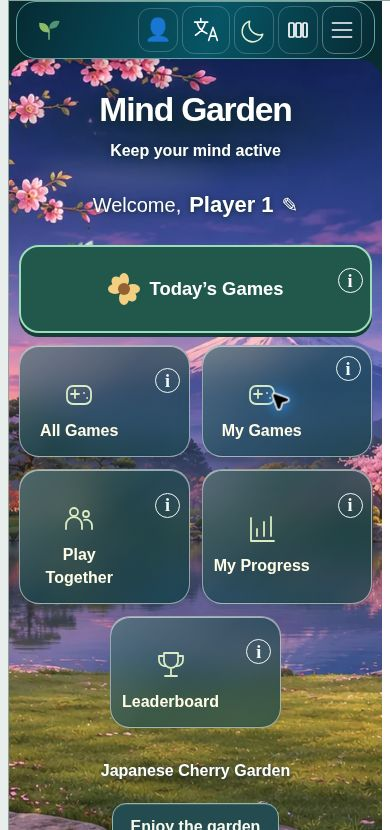
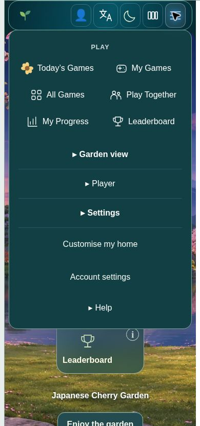
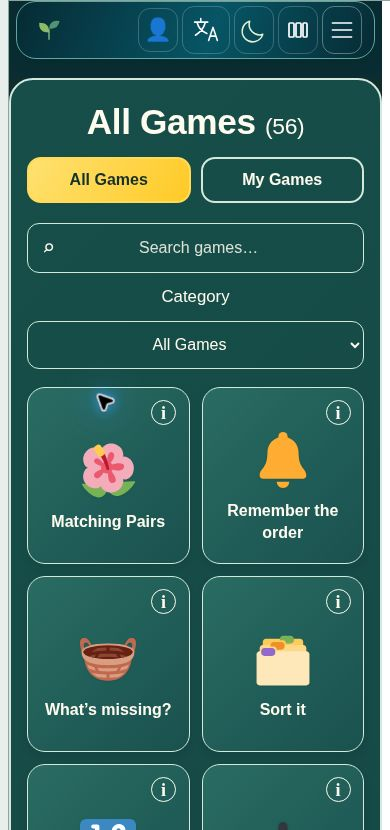
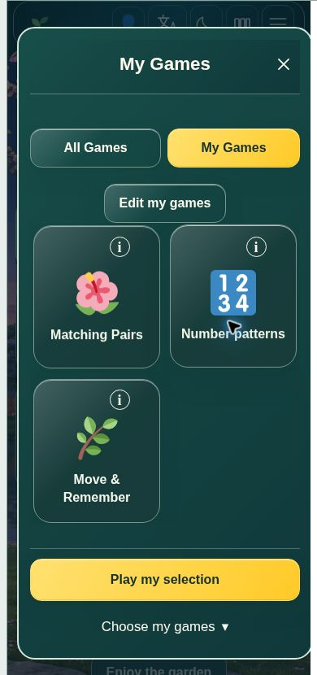
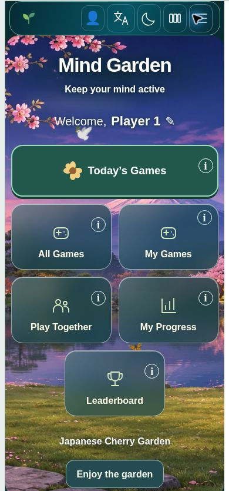

# Combined design preview — v5.0.5

Local implementation only. Not pushed or deployed. New background artwork remains excluded.

## Changes

- Consolidated competing welcome, toolbar and catalogue rules in v5.css into owned component sections. Existing legacy theme sheets remain; this is not a claim of a complete application-wide CSS rewrite.
- One primary Today’s Games action, visible icons, centred headings and an unpaired final shortcut centred in its row. The outer panel around the welcome cards is removed.
- Compact reference menu retained. Essential toolbar actions remain accessible; desktop destinations appear as space permits. Width measurement ignores CSS-hidden controls.
- All Games and My Games share adaptive card proportions, 56px borderless artwork, contextual help and concise visible content. Category dropdown and bracketed count retained. Narrow/large-text lists collapse to one column.
- Every welcome checkbox is honoured, including Today’s Games and All Games. The overall game-card toggle persists. Enjoy the garden hides cards and expands scenery to the viewport, with progress below; Back to games restores the chosen cards.
- Contextual information dialog headings and a single close action, with focus restored to the opener.
- Approved gameplay, exact-identity device-copy deletion and newer progression work retained.
- English and Chinese About copy updated. Versioned assets rebuilt as 5.0.5.

## Validation

15 targeted test files passed: review-ui, navbar-overflow, v5-flow, dashboard-preferences, device-copy-removal, profile-restoration, menu-navigation, about-documentation, game-ui-approved, v504-consistency, release-cache, popup-shell, live-language, account-sync and device-signin. npm run check passed. Build passed.

Updated stale tests to reflect the approved behavior, including hiding an explicitly unchecked primary card, contextual modal help, the labelled Menu control and returning from saved results without an unsaved-play warning. Existing tests still exercise game cancellation, saved-copy isolation, storage failure, restores and bilingual navigation.

Rendered checks in Chrome: 390px phone, 768px tablet and 1200px desktop; dark English and light Chinese; 200% catalogue text produces a single column with no document horizontal overflow; native information dialog; reference menu; garden-only view and return. Confirmed My Games artwork measures 56px with zero border/padding and a transparent background. This does not substitute for physical Safari/Android, screen-reader or live eight-device multiplayer testing.

Preview-only cached assets were isolated from the production build. Review harnesses remain outside public/.

## Screenshots

## Mobile card centring correction

Removed the legacy 60px right-padding reservation for information buttons in personal-games.css. The help controls remain independently positioned. Rendered at 390px: each secondary card's icon and label centre matches its card centre within 0.01 CSS pixels; Today’s Games icon-and-label group is centred as a unit. Build passed; no deployment.

