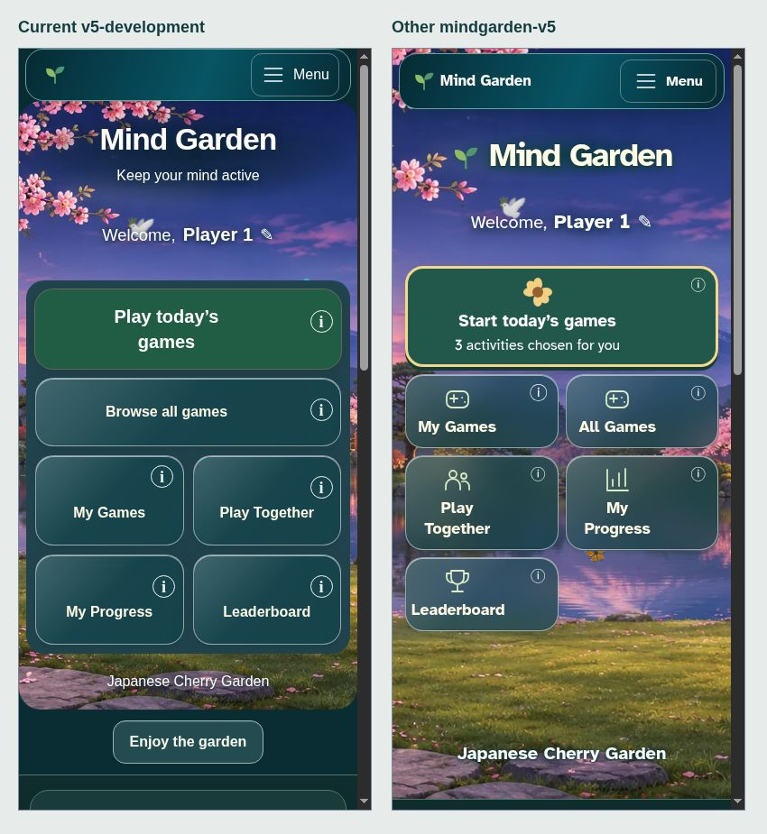
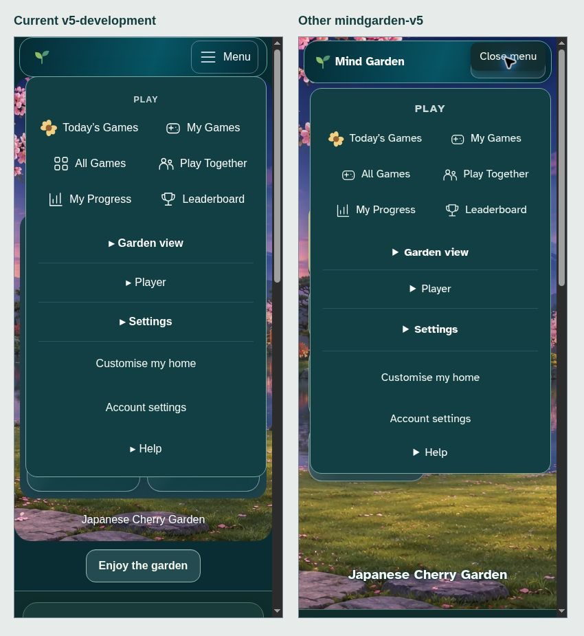
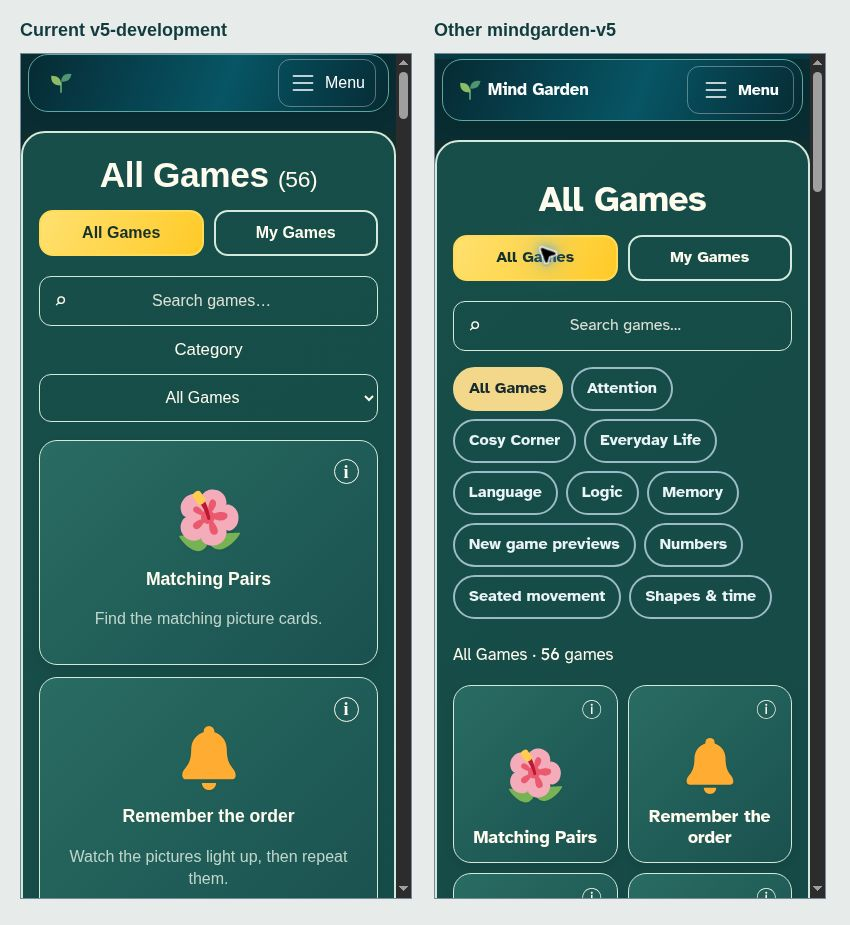
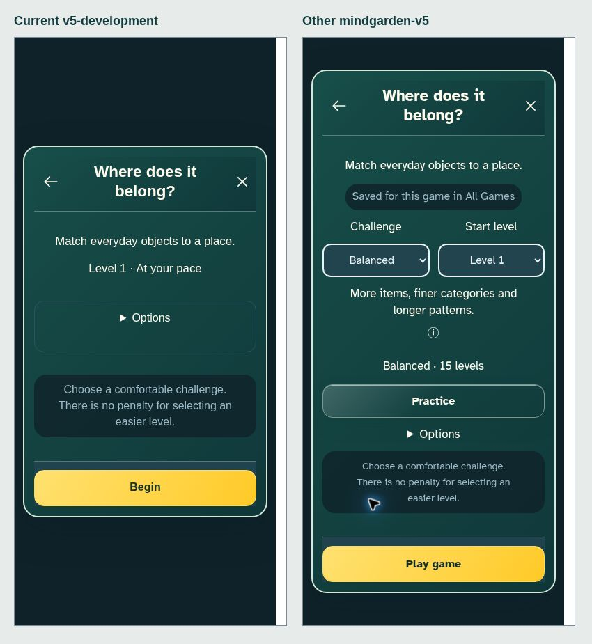
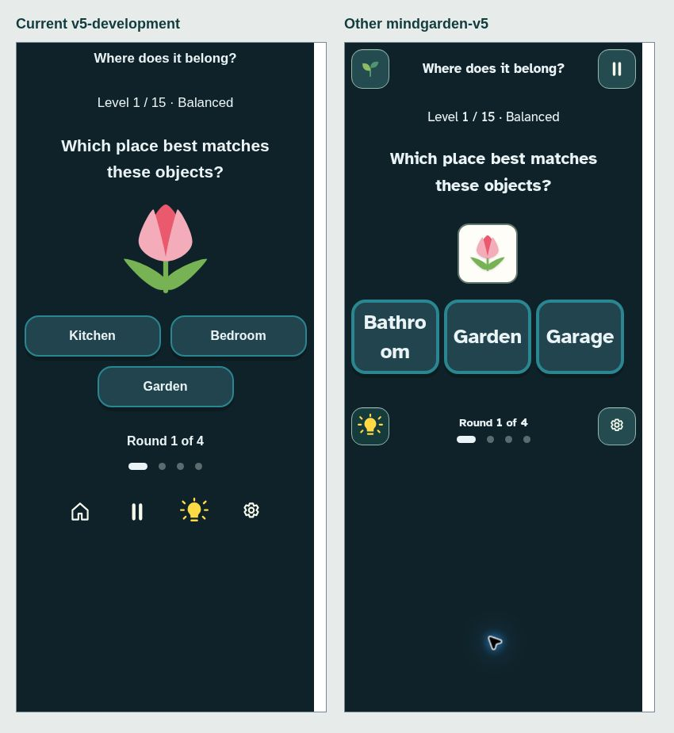

# Mind Garden comparative review

Reviewed 16 November 2026. Deployment remains paused. No application code was changed by this audit.

## Verdict

The other version presents a better first impression and a clearer starting point. Our current branch provides the better revised gameplay experience and preserves more of the user's recent requirements. Neither should be accepted as uniformly superior or shipped without further checks. Keep v5-development as the integration base, adopt selected presentation ideas from mindgarden-v5, and consolidate the shared UI rules instead of adding another override layer.

This is an engineering and usability review, not a clinical assessment or a user study with older players.

## Exact comparison

- Current: mindgarden, v5-development, local commit a5019bfb5608a51664fb38e2d51503f2d11e3186. Includes the pending menu and device-copy deletion fixes; these are NOT deployed.
- Other: Pebblebrooks/mindgarden-v5, main, commit 650a31314341bc036b3b1f4c78d19b048db3d319.
- Existing production is a separate baseline; do not confuse pending fixes with what the user currently sees.
- 447 public files are byte-identical. The functions and shared directories are identical. These are substantially the same application family, not independent game engines.
- Inspected source differences across navigation, dashboard/preferences, game controls, accounts, local records, games, progression, scenery, localization and styles. Rendered both at a 390px phone-sized viewport with comparable dark-mode state; interacted with home, menu, catalogue, game preparation, gameplay, settings and exit warnings. Ran eight targeted test files per repository.

## Player-facing comparison

| Area | Assessment | Recommended action |
|---|---|---|
| Welcome screen | Other is stronger: a visibly primary Today’s Games action, recognizable icons and secondary choices. Our mobile cards lose their icons and have excessive nested panels. | Adopt the hierarchy and restore meaningful icons; use concise labels and avoid extra explanatory sentences. |
| Navigation | Other keeps a readable Mind Garden brand at phone width and has a more intentional desktop/mobile split. Our current stylesheet hides navigation actions broadly, even where space exists. | Retain the compact reference menu; replace blanket hiding with an explicit responsive priority order. |
| Dropdown menu | Both latest local versions have two play columns; other spacing is already close to the supplied reference. Our pending menu is substantially improved over the deployed screenshot. | Reuse spacing principles, not an entire menu implementation. Keep centred disclosures, triangular markers, dividers and balanced margins. Allow a single column at large text sizes. |
| All Games filters | Ours is better for this brief. The dropdown is compact. The other's eleven category chips consume much of a phone screen before games appear. | Keep dropdown, search and small bracketed count. Do not adopt chips. |
| All Games cards | Other fits more games with two columns and fewer words. Ours supplies useful descriptions but requires much more scrolling. Other titles still wrap; removing all descriptions reduces clarity for unfamiliar games. | Use one shared adaptive card component: two columns when comfortably readable, one when enlarged text or long titles require it. Optional details belong in accessible information controls. |
| My Games | Other contains compact/full-width styling and an explicit removal mode. Ours has newer shared catalogue-card work. Source inspection does not justify reverting that work. | Both lists must use the same component, illustration size, information position and spacing. Verify in empty, one-card and many-card states. |
| Game preparation | Ours is simpler in the tested game: one description, level summary, optional settings, Begin. Other exposes more selectors, practice and explanatory text immediately. | Retain our progressive disclosure; keep practice available without turning the preparation screen into a form. |
| Where does it belong? | Ours clearly wins the rendered comparison: large borderless picture, compact readable answers, separated progress and a single control row. Other retains a small picture, oversized answer text and split controls; Bathroom breaks inside the word. | Keep our gameplay layout. Apply its sizing rules consistently, without assuming every game has identical content. |
| In-game settings | Our Change level label makes the action clearer. Other retains the nested gear/restart action that prompted confusion. | Keep semantic action labels where an icon is ambiguous. Make any loss of the unfinished round explicit. |
| Exit confirmation | Both protect an unfinished game on Home. Our compact three-row wording matches the approved design. Other uses the older verbose dialog. | Preserve our contract: ordinary menu Back restores the previous step; warn when an action actually risks unsaved play. |
| Information dialogs | Other has useful contextual help titles and reuse of its overlay shell. Our generic Information shell can lose context. | Adopt contextual titles and consistent close/focus behavior; retain a single visible circle and an invisible generous hit area. |
| Saved device copies | Other's removal path still captures copies rather than reconciling deleted IDs. It therefore does not solve the reported stale-player-copy issue. Our local pending path reconciles stable IDs and provides individual copy deletion. | Keep our pending fix. Test storage failure and same-name identities; do not delete by name or promise to rewrite downloaded files. |
| Customise my home | Source shows our apply logic exempts Today’s Games and All Games from individual hide preferences, while presenting choices for them. Other applies the selected visibility consistently. | Resolve this mismatch: honour the checkbox or clearly make those two actions fixed and remove misleading controls. Prefer honouring player choice. |
| Scenery and immersion | Other still includes retired scenery assets. New generated imagery remains undecided. No basis to claim the other fixes saturation. | Preserve approved current assets. Finish full-view garden behavior and removal of empty space when progress is hidden before adding more art. |
| Progress and motivation | Most underlying logic is shared. Our newer bouquet continuation should not be overwritten by older files. | Keep saved achievements and an optional next growth cycle; avoid mandatory streak pressure. Verify the full-bloom state explicitly. |
| Accounts and multiplayer | Backend source is identical; targeted account and eight-player room tests pass in both. No evidence of a backend advantage for either. | Retain the existing implementation and deployment origin. Validate real cross-device sessions separately. |
| Language and accessibility | Both contain bilingual logic and accessible labels; the other has some useful language/help refinements. Neither automated test results nor a phone-width screenshot certify accessibility. | Verify Chinese, keyboard focus, screen-reader names, 100–200% text, light/dark contrast and touch help. Never rely on hover alone. |

## Visual evidence

All screenshots show current v5-development on the left, other mindgarden-v5 on the right. They are local rendered applications, not generated mockups. Phone-sized Chrome rendering is not physical iPhone/Safari validation.

### Welcome

### Menu

### Catalogue

### Preparation

### Gameplay

## Code quality and performance

Our v5.css contains 680 !important declarations versus 85 in the other v5.css. Across non-generated CSS, the counts are 1,675 versus 1,080. These are indicators of cascading override complexity, not independent defects, but our substantially larger override burden makes predictable component styling harder. Our repeated visual regressions are consistent with this maintenance weakness. It is not enough to keep appending fixes.

The other version is not a clean rewrite either: it inherits the same underlying code and adds DOM-observer enhancement layers. Reusing its whole bundle would bring back older behavior alongside its improvements.

Raw release bundle sizes: current JavaScript 1,410,130 bytes and CSS 299,804 bytes; other JavaScript 1,476,043 bytes and CSS 270,922 bytes. Other CSS is smaller, but JavaScript is larger. This is not a measured loading-speed comparison. Neither bundle size alone nor a screenshot proves runtime performance. Measure transfer compression, startup execution and interaction latency on an ordinary phone before claiming a speed improvement.

## Tests run and interpretation

Eight targeted test files were executed against each repository. Current: six passed and two failed. Other: eight passed.

Both passed menu navigation, profile restoration, release/cache handling, About documentation, account API and eight-player room tests. Our failures were review-ui (an expected welcome-card ordering) and navbar-overflow (an expected empty Menu label). These assertions are out of step with the current design; they do not by themselves prove a runtime failure. They nevertheless mean our selected suite is not green and must be reconciled with the approved specification. The other version passing its own expectations is not proof it satisfies the user's newer requirements.

Full logs are recorded in test-results.json. Tests are not interchangeable product scores. Account and room tests simulate behavior; they do not prove a production D1 binding or eight real devices are working.

Not exhaustively validated: all 56 games at all difficulty levels; physical iOS/Android and tablet landscape; full bilingual/light-mode/200% text matrix; live account deletion or recovery; real multiplayer synchronization under adverse networks; a complete security penetration test; assistive-technology testing. No real player records were deleted during this audit.

## Adoption plan before release

1. Consolidate navigation, card, dialog and game-control styling into owned components and shared spacing/type/icon variables. Remove superseded rules after verifying computed behavior. Avoid another blanket override patch.
2. Borrow the other welcome hierarchy, visible meaningful icons, contextual help titles and responsive width handling. Keep the user's dropdown filters, concise copy and reference menu arrangement.
3. Preserve our recent fixes: game picture/answer proportions, grouped controls, preparation deduplication, compact loss warning, device-copy reconciliation and newer progress/scenery decisions.
4. Resolve customisation controls that do not do what they promise. Check hiding progress/cards and entering/leaving full garden view.
5. Align tests to the approved behavior, then run the actual regression matrix, including real rendered screens. Keep data-safety tests for cancellation, exact identity, storage failure, reload and sign-out.
6. Present a working preview of the combined result before deployment. Keep the existing Pages origin so local storage and origin-bound device authentication are not needlessly migrated. No new background artwork is included without selection.

## Reuse map

Candidate source files in the other repository: public/v5.css (selected layout rules), public/responsive-nav.js (visible-element width budgeting), public/info-help.js (contextual help), public/v5.js (presentation refinements). Reuse behavior at component level; do not copy these files over current files wholesale. Preserve current public/game-ui.js, progression.js, personal-games.js and local-player-records.js improvements while unifying presentation.

About text must describe the actual combined release in both languages after implementation. This review itself does not change shipped behavior or the app version.
