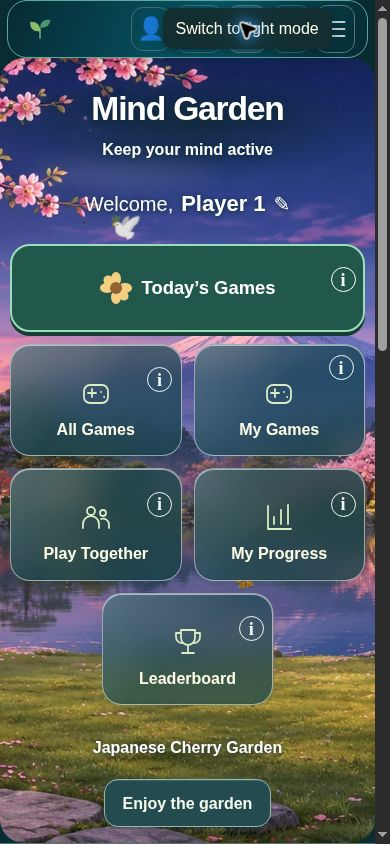

# v5.0.5 deployment receipt

Approved by the user and deployed 16 November 2026.

- Production: https://mindgarden-bk1.pages.dev/
- Deployment URL: https://18be2f01.mindgarden-bk1.pages.dev
- Remote branch: v5-development
- Remote release commit: b7e094b1c4bb03510f78968289e134c92c7a3f6d
- Exact release tree: 07d600a3a2c5252616f59b03c150bed77fce617a (matches local approved tree)
- Cloudflare Pages check 133056139686: completed / success.
- Live DOM confirmed release v5.0.5 and garden-ui-505.css at the production URL.
- Live 390px frame measurements: all six home card content groups centred within 0.008 CSS pixels.
- Prior 15 targeted suites and syntax checks passed; release-cache and device-copy-removal checks rerun before publication passed. Final centred CSS built successfully.
- No database migration; no unselected scenery added.
- Existing independent Workers integration auto-ran and failed. It was not changed or retried; the requested Pages deployment succeeded.

