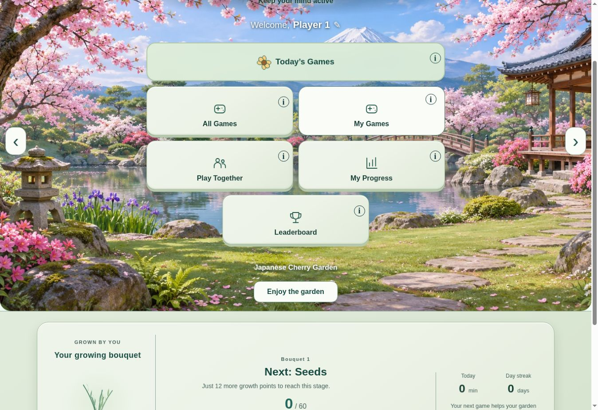

# v5.0.6

Approved language revisions and pending fixes, 16 November 2026.

- Shortened 54 English/Chinese description pairs; removed redundant Contact, scenery and text-size instructions and shortened empty states.
- Rankings retain access/storage information in an accessible info control. Save, deletion and password-file warnings remain visible.
- Corrected outdated control positions and card visibility documentation; removed the repeated generic gentle-mode explanation.
- Centred submenu labels and retained the two-column Play section.
- Back to games restores cards hidden by the navbar toggle; individual card selections remain intact.
- Invitations appear above popups. Expired lobby sessions show a reconnect action. Enter lobby is visible without opening Create room.
- Regression coverage includes invitation delivery/acknowledgement with another popup open, expired-session recovery, ranking details, bilingual card toggles, account sync, device sign-in, navigation and release caches.
- English/Chinese mobile browser review completed. The broad all-games setup sweep was interrupted after exceeding the practical run time; targeted gameplay and navigation checks are recorded separately.
- Pale sage Today’s Games card in light mode; visible navbar game links centred against the full navbar. Browser measurements at desktop width: centre offset under 0.01 CSS px; narrow layouts do not overflow.
- No database migration and no new scenery.

Cloudflare Pages check 133070948509 completed successfully.

- Production: https://mindgarden-bk1.pages.dev/
- Deployment: https://45b6b1e2.mindgarden-bk1.pages.dev
- Remote commit: 25212da63f9029bfd49786b56ba00157b6d6c9ea
- Tree: ee17088558ab6fbb44e4a3171e8e00af87d8fec1 (matches local release)
- Live DOM: v5.0.6, garden-ui-506.css, pale card rgba(221,237,216,0.94), navbar centre offset -0.0078px.
- Final dashboard preferences, 36 navbar-fit combinations and atomic release-cache checks passed.

